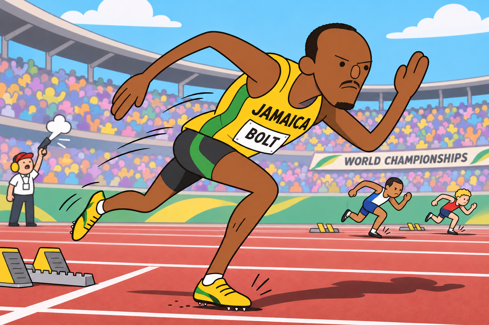

# Cartoon Jake

A Codex skill for expressive 2D cartoons with rounded shapes, clean black outlines, and vivid flat colors. It applies the same visual language across sports, everyday activities, conversation, teamwork, animals, fantasy, and quiet scenes.

The instructions coordinate the entire scene, including background participants, shared objects, physical contact, and lighting.

They also preserve a clear focal subject. An approved close-up keeps its framing and protagonist scale while corrections address supporting details.

## Usain Bolt's first step

This approved example depicts Usain Bolt taking his first step after the starting gun at the World Championships.



The close-up makes Bolt the clear protagonist. Smaller background competitors have also left their blocks and begun their first strides. The skill retains this image as a composition reference for protagonist-led scenes and adapts the framing to each request.

The original request, translated into English, was

```text
$artifact-template-cartoon-jake Draw Usain Bolt taking his first step just after the starting gun at the World Championships.
```

## Installation

Use Codex with access to the `imagegen` skill and an image generation tool. Ask the skill installer to install this repository's skill folder.

```text
$skill-installer https://github.com/rlatjr8362/cartoon-jake-skill/tree/main/skills/artifact-template-cartoon-jake
```

After installation, invoke `$artifact-template-cartoon-jake` in your next request. The skill's display name is **Cartoon Jake**.

## Default creative direction

| Area | Default |
| --- | --- |
| Shared timing | Coordinate participants around the same event, with small natural differences in reaction and pose. |
| Cartoon exaggeration | Keep balance, weight, contact, and cause and effect believable while exaggerating shape and elasticity. |
| Supporting participants | Include people or creatures that the situation calls for, following explicit subject counts. |
| Background detail | Simplify faces and clothing while keeping readable actions, gaze, support, and shadows coherent. |
| Camera | Make the intended protagonist or group the clear focus while revealing the important action. Preserve approved framing and subject scale during corrections. |
| Real subjects | Verify defining appearance, representative clothing, equipment, and key actions using relevant reliable references. |
| Effects | Use moderate, purposeful effects that make effort and movement easy to read. |
| Review | Inspect the full scene and its readable background participants, then correct material inconsistencies before final delivery. |

Explicit instructions in a request can change these defaults. Specific event years and historical details are researched when they are part of the requested scene.

## Usage

Describe who or what is in the scene, what is happening, and the moment you want to capture. Add a setting, expression, camera angle, lighting direction, or transparent background requirement when it matters.

### Sport

```text
$artifact-template-cartoon-jake Draw the first step after the starting gun at a sprint final. Keep all visible competitors in compatible stages of early acceleration, with small natural differences in their strides.
```

### Cooperation and object handling

```text
$artifact-template-cartoon-jake Draw two friends carrying a wooden table through a doorway. Make their grips, shared load, steps, and the table's angle work together.
```

### Everyday activities

```text
$artifact-template-cartoon-jake Draw Jake preparing breakfast while a friend hands him a bowl. Show the instant both characters support the bowl, with clear hand contact and coordinated attention.
```

### Quiet and emotional scenes

```text
$artifact-template-cartoon-jake Draw a student listening to a friend at a cafe. Use their expressions, gaze, posture, and distance to convey a thoughtful conversation.
```

### Fantasy

```text
$artifact-template-cartoon-jake Draw a small wizard lifting a stone with magic while a companion watches. Make the stone's position, the characters' reactions, and the magical light agree.
```

The skill carries the saved cartoon style across subjects while retaining their defining appearance and clothing. It adapts the physical details to each activity and the requested fictional rules.

## How scene review works

For a race start, all visible competitors should respond to the same signal and fit the brief time elapsed. For a handoff, the participants' hands and the object's position should agree. For a conversation, gaze and gestures should explain who is attending to whom.

Review covers the main subject, interacting props, readable background figures, spatial relationships, and lighting. Focused corrections address material errors while retaining successful visual choices.

For a protagonist-led scene, review also checks that the main subject retains the intended prominence. Background corrections preserve an approved close-up and its dynamic silhouette.

## Repository layout

```text
cartoon-jake-skill/
├── README.md
├── examples/
│   └── usain-bolt-first-step.png
└── skills/
    └── artifact-template-cartoon-jake/
        ├── SKILL.md
        ├── artifact-template.json
        ├── agents/
        │   └── openai.yaml
        ├── assets/
        │   ├── preview.png
        │   ├── reference.png
        │   ├── reference-action.png
        │   ├── reference-contact.png
        │   └── usain-bolt-composition.png
        └── references/
            ├── motion-and-light.md
            └── scene-coherence.md
```

The skill folder includes creation instructions, interface metadata, three style references, an approved composition example, a template preview, and detailed guidance for physical action and scene consistency. [Skill instructions](skills/artifact-template-cartoon-jake/SKILL.md) · [Motion and lighting](skills/artifact-template-cartoon-jake/references/motion-and-light.md) · [Scene coherence](skills/artifact-template-cartoon-jake/references/scene-coherence.md)
